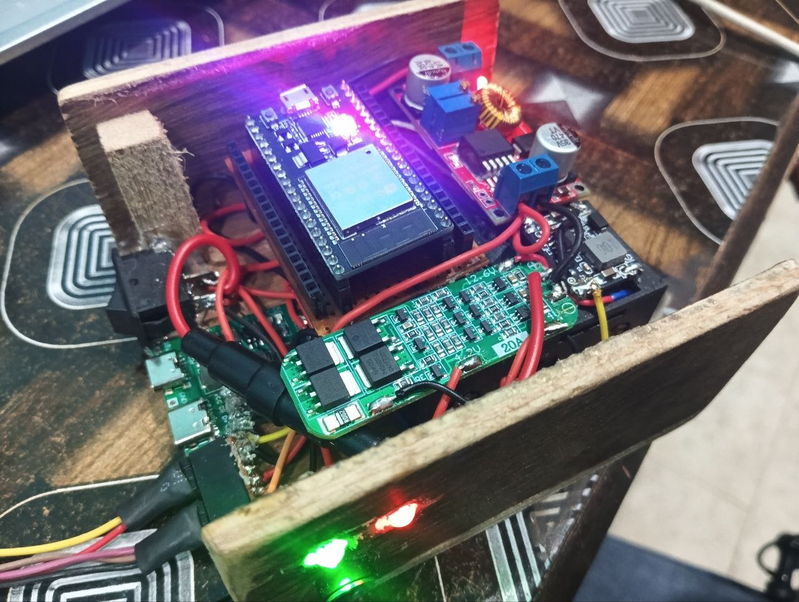

# Portable Bench PSU — one box, two rails

**One 3S1P power box with a fixed 5 V logic rail and a separate adjustable high-current rail. Built once, reused across projects — the laser turret is one current load, not the reason the box exists.**

---

## What it is

A single enclosure with two independent buck rails on one common ground:

| | |
|---|---|
| **Input 1** | 12 V 2 A wall adapter → barrel jack (centre = +) |
| **Input 2** | 3S1P 18650 pack (3 × 1800 mAh, ~20 Wh) with 3S BMS + 5 A fuse |
| **Charging** | 5 V USB-C → 3S 1 A boost charger, charges the pack in place |
| **Logic rail** | MP1584 **fixed 5 V** — MCU / ESP32 / receiver electronics |
| **Load rail** | XL4015 **CC/CV, adjustable 1.2 V … (Vin − 1.5 V)** — servos, laser, loads under test |
| **Ground** | One common GND node across both rails |
| **Output** | 5-pin header + Type-C breakout on the variable rail |

The adjustable rail is dialled per project. For the laser turret it is currently set to
**5 V, CC 2.0 A** so two SG90 servos and the laser never draw through the logic rail.
For the next build, turn it to whatever that load needs — the box is not turret-specific.

Demo of the box powering the turret:

---

## Current configuration (laser turret load)

| Header pin | Signal | Current use |
|---|---|---|
| 1 | Fixed 5 V (MP1584) | ESP32 bridge + STM32 Blue Pill logic |
| 2 | Variable rail (XL4015, set 5 V / CC 2 A) | 2× SG90 servo + 5 V laser |
| 3 | ESP32 TX | → Blue Pill PA10 |
| 4 | ESP32 RX | ← Blue Pill PA9 |
| 5 | GND | common ground |

Full wiring, safety rules and the bring-up faults are in [`PSU.md`](PSU.md) and
[`BUILD_NOTES.md`](BUILD_NOTES.md).

---

## Design decisions worth knowing

| Decision | Why |
|---|---|
| Charger `OUT+` lands after the fuse (node A) | A shorted charger blows the fuse instead of dumping amps into the pack |
| XL4015 is buck only | Max output ≈ Vin − 1.5 V; from 9.9 V you get ~8.4 V |
| Type-C breakout is on the **variable** rail, CC pins open | Power-only 2-wire port, marked `VAR V` — it is **not** 5 V |
| One LED on node B, one switched LED on node A | The original 1 kΩ always-on LED drained 10.6 mA 24/7 and flattened the pack in ~7 days |
| SPST switch instead of a source selector | The 3-pin selector was lost; adapter/battery conflict is avoided by discipline — see safety rules |

---

## Safety rules

1. **Adapter plugged in ⇒ switch OFF.** With an SPST switch both sources can reach node B.
2. **Pack floor 10.5 V (3.5 V/cell).** The BMS cutoff is last-resort protection, not a fuel gauge.
3. **Charge with the switch OFF and the 12 V adapter unplugged.** Phone charger only.
4. Charger goes to `P+`/`P−` only — never `B+`/`B−`, which bypasses the protection FETs.
5. Verify the `B−`/`B1`/`B2`/`B+` staircase before connecting `P+`.
6. One ground, one point.

The build’s two real faults — a dead BMS charge path and the parasitic indicator LED — are
documented in [`build_guide.md`](build_guide.md) → *Fault Log*.

---

## Documents

| File | Contents |
|---|---|
| [`PSU.md`](PSU.md) | As-built rails, header map, wiring, power budget, safety rules |
| [`BUILD_NOTES.md`](BUILD_NOTES.md) | Physical faults found and fixed, bring-up and flashing gotchas |
| [`build_guide.md`](build_guide.md) | As-built wiring, node map, gate-by-gate checks, full fault log |
| [`psu_plan.md`](psu_plan.md) | Architecture, parts, design rationale, phases |
| [`notebook.md`](notebook.md) | The electronics learned here — V/I/P, BMS cutoffs, charger maths, fault-finding |
| [`MEDIA.md`](MEDIA.md) | Photo and video slots, demo links |

---

## Built By

Harish Chand — `forgeVII`. Personal build: learning, experimenting, shipping.

---

## License

MIT License — use freely, build your own, share what you make.
